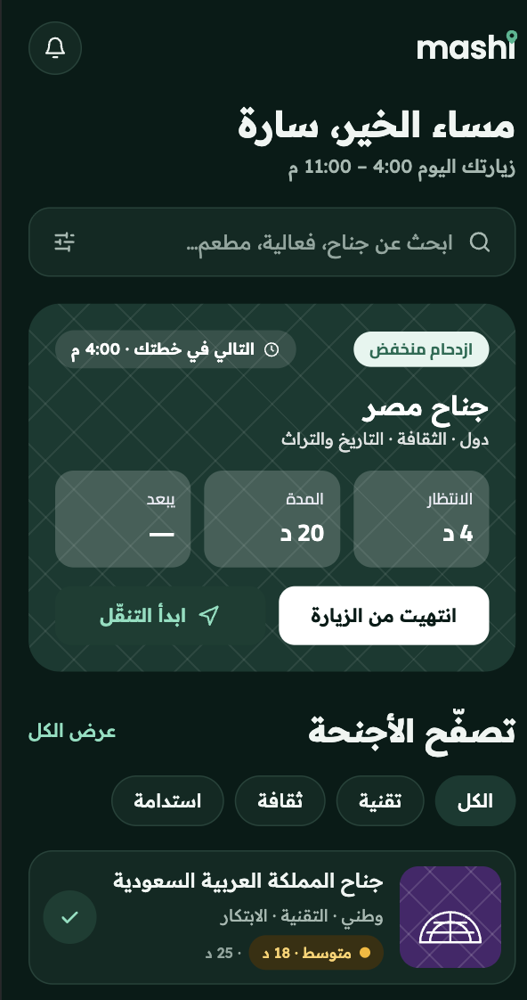
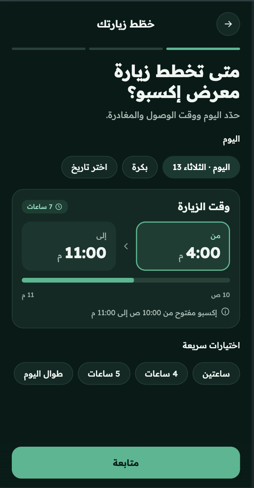
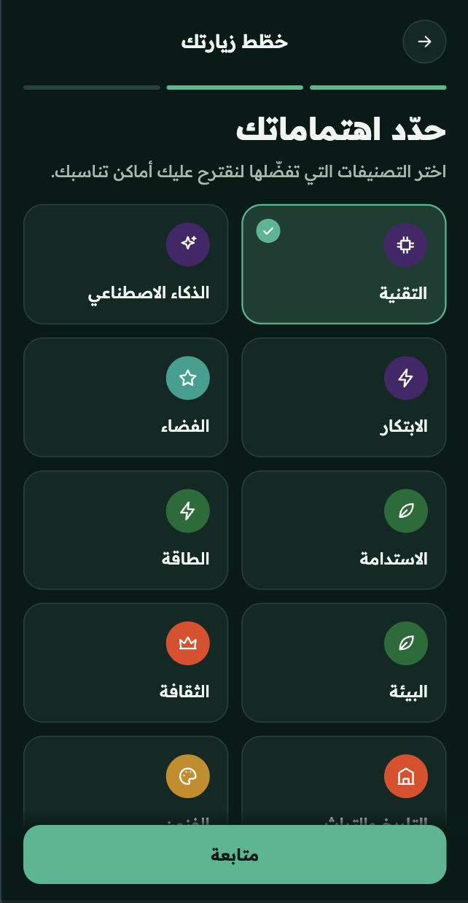
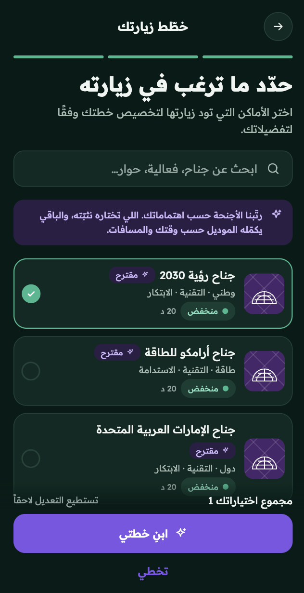
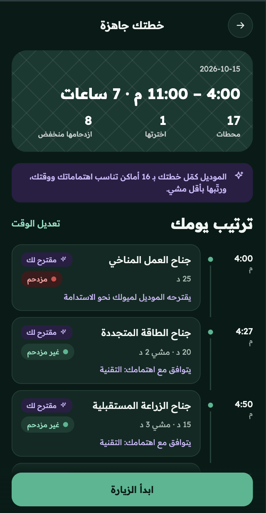
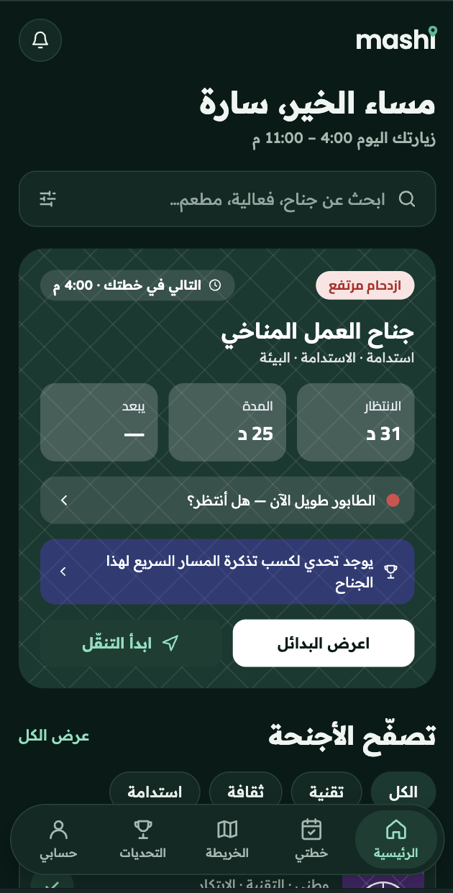
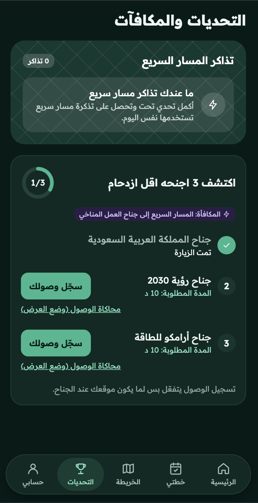
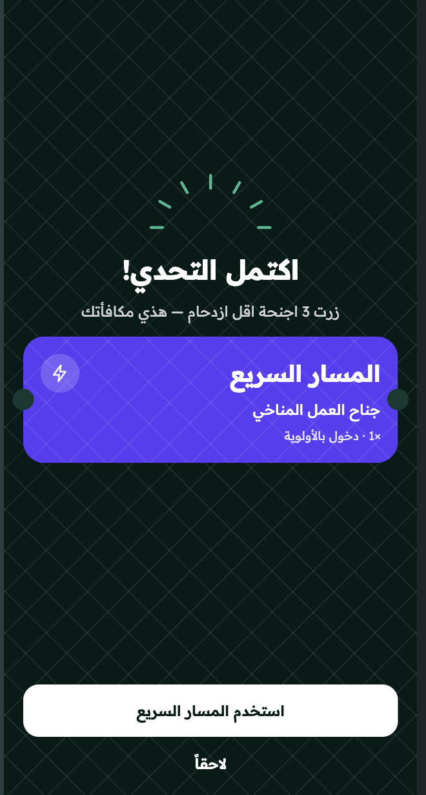

# mashi | ماشي
### Smart Visitor Planner for Expo 2030 Riyadh

ماشي هو مشروع Web MVP تجريبي يهدف إلى تحسين تجربة زوار إكسبو 2030 الرياض من خلال إنشاء خطة زيارة مخصصة، تنظيم الوقت، مراعاة اهتمامات الزائر والمسافات بين الأجنحة، والتعامل مع الازدحام من خلال نظام **Discover & Earn**.

> **تنبيه:** هذا المشروع عبارة عن MVP Demo لأغراض إثبات الفكرة والعرض.  
> بيانات الأجنحة والمواقع ومستويات الازدحام المستخدمة حاليًا بيانات محاكاة وليست بيانات رسمية أو مباشرة من Expo 2030.

---

## فكرة المشروع

في الفعاليات الكبيرة مثل Expo قد يواجه الزائر عدة تحديات:

- كثرة الأجنحة وصعوبة تحديد الأنسب له.
- محدودية وقت الزيارة.
- المسافات بين الأجنحة.
- الازدحام وطوابير الانتظار.
- ضياع جزء كبير من وقت الزيارة في الانتظار.

يقدم **mashi** تجربة تساعد الزائر على بناء خطة مناسبة لوقته واهتماماته، ثم تتفاعل مع حالة الازدحام.

يدخل المستخدم:

- وقت الوصول والمغادرة.
- اهتماماته.
- الأجنحة التي يرغب في زيارتها.

بعد ذلك يقوم النظام بترتيب الأجنحة وإنشاء خطة زيارة مناسبة.

إذا كانت الوجهة التالية ذات ازدحام مرتفع، يمكن للنظام تشغيل تجربة **Discover & Earn** واقتراح 3 أجنحة أقل ازدحامًا.

بعد إكمال التحدي يحصل المستخدم على **Fast Lane Pass** يحتوي على QR Code مخصص للجناح المزدحم.

---

# أهم وظائف المشروع

## 1. Smart Visit Planning

ينشئ النظام خطة زيارة بناءً على:

- اهتمامات المستخدم.
- الأجنحة التي اختارها.
- الوقت المتاح.
- مدة زيارة كل جناح.
- المسافة بين الأجنحة.


لا يقوم النظام فقط بعرض الأجنحة، بل يحاول اختيار مجموعة يمكن زيارتها فعليًا خلال الوقت المحدد.

---

---

# 🌐 Live Demo

يمكن تجربة النسخة المنشورة من المشروع مباشرة عبر Railway:

### 🚀 [Try mashi Live Demo](https://mashexpohackathon-production.up.railway.app/)

> بيانات الأجنحة ومستويات الازدحام المستخدمة في النسخة التجريبية هي بيانات محاكاة وليست بيانات رسمية أو Live من Expo 2030.

---

## 2. Interest Recommendation Model

يحتوي المشروع على موديل محفوظ في:

```text
planner/ml/interest_model.joblib
```

يعمل نظام الاهتمامات على 7 أبعاد:

```text
tech
heritage
sustainability
family
food
entertainment
global
```

بينما يتعامل المستخدم مع اهتمامات عربية مثل:

```text
التقنية
الذكاء الاصطناعي
الابتكار
الفضاء
الاستدامة
الطاقة
البيئة
الثقافة
التاريخ والتراث
الفنون
الصحة
الترفيه
الألعاب
الطعام
التسوق
```

يتم تحويل اختيارات المستخدم إلى أوزان يمكن للموديل التعامل معها.

درجة توصية الجناح تعتمد على:

```text
70% Model Score
30% Direct Interest Match
```

وفي حال تعذر تحميل الموديل، يوجد Fallback يعتمد على التطابق المباشر بين اهتمامات المستخدم واهتمامات الأجنحة.

---

## 3. Time & Distance Optimization

يحتوي المشروع على خدمات لحساب المسافة بين الأجنحة وتقدير وقت المشي.

سرعة المشي المستخدمة في المحاكاة:

```text
80 meters/minute
```

ويستخدم النظام:

- مدة زيارة الجناح.
- وقت المشي.
- الوقت المتبقي.
- درجة توصية الجناح.

لبناء خطة يمكن تنفيذها ضمن الفترة التي أدخلها المستخدم.

---

## 4. Crowd-Aware Experience

لكل جناح مستوى ازدحام:

```text
LOW
MEDIUM
HIGH
```

إذا أصبحت الوجهة التالية في الخطة:

```text
HIGH
```

يمكن للمستخدم الدخول إلى تجربة **Discover & Earn** بدل الانتظار مباشرة.

> مستويات الازدحام الحالية محاكاة وليست بيانات Live من Expo.

---

## 5. Discover & Earn

عند وجود جناح مزدحم، يبحث النظام عن 3 أجنحة بديلة أقل ازدحامًا.

يقوم المستخدم بزيارة الأجنحة الثلاثة وإكمال الوقت المطلوب في كل جناح.

يتم حفظ:

- بداية الزيارة.
- نهاية الزيارة.
- حالة إكمال الزيارة.
- عدد الزيارات المكتملة.

ويظهر تقدم المستخدم حتى:

```text
3 / 3
```

---

## 6. Location Verification

يدعم المشروع استخدام:

```text
Browser Geolocation API
```

للحصول على موقع المستخدم بعد إعطائه الإذن.

يقارن Django إحداثيات المستخدم بإحداثيات الجناح.

نطاق التحقق المستخدم حاليًا:

```text
100 meters
```

إذا كان المستخدم قريبًا من الجناح، يبدأ وقت زيارة التحدي.

### مهم

النسخة الحالية تتحقق من الموقع **عند تسجيل الوصول** فقط.

لا يوجد Continuous GPS Tracking للتأكد من بقاء المستخدم بجانب الجناح طوال مدة الزيارة.

---

## 7. Challenge Timer

في الوضع الطبيعي تعتمد مدة التحدي على:

```python
challenge_visit_minutes
```

لكن المشروع يعمل حاليًا في:

```python
DEMO_MODE = True
```

لذلك تم تقليل مدة زيارة جناح التحدي إلى:

```text
10 seconds
```

حتى يمكن عرض دورة التحدي كاملة أمام المحكمين دون الانتظار لعدة دقائق.

---

## 8. Fast Lane Pass & QR Code

بعد إكمال:

```text
3 / 3
```

يقوم النظام بإنشاء **FreePass** مرتبط بالجناح المزدحم.

كل تصريح يحتوي على:

- UUID فريد.
- الجناح المرتبط بالتصريح.
- حالة الاستخدام.
- وقت الاستخدام.

ثم يتم إنشاء QR Code يحتوي على رابط التحقق من التصريح.

عند التحقق، يتأكد النظام من:

```text
Challenge Completed
+
Pass Not Used
```

وبعد استخدام التصريح يتم تسجيله كمستخدم لمنع استخدامه مرة أخرى.

---

# البيانات المستخدمة

يحتوي المشروع على Dataset خاصة بالمحاكاة:

```text
planner/data/expo2030_pavilions_project.json
```

وتحتوي النسخة الحالية على بيانات **40 جناحًا** و **15 اهتمامًا**.

من البيانات الموجودة للأجنحة:

- الاسم بالعربية والإنجليزية.
- التصنيف.
- المنطقة.
- Latitude.
- Longitude.
- السعة.
- عدد الزوار المحاكى.
- Crowd Ratio.
- Crowd Level.
- Wait Time.
- Experience Duration.
- Opening Hours.
- Interests.
- Description.
- Highlights.
- Challenge Visit Duration.

هذه البيانات مخصصة للمحاكاة وليست بيانات رسمية من Expo 2030.

في التطبيق الحقيقي يمكن استبدال بيانات المحاكاة ببيانات رسمية وLive APIs من أنظمة الحدث دون تغيير الفكرة الأساسية للنظام.

---

# التقنيات المستخدمة

### Backend

```text
Python
Django 6.1+
SQLite
Django ORM
Django Sessions
```

### Machine Learning

```text
scikit-learn 1.9.1
NumPy
Joblib
interest_model.joblib
```

### Frontend

```text
HTML
CSS
JavaScript
Django Templates
Fetch API
```

### Location & Distance

```text
Browser Geolocation API
Latitude / Longitude
Distance Calculation
Walking Time Estimation
```

### QR & Fast Lane

```text
qrcode
Pillow
UUID
Base64
```

### Configuration

```text
python-dotenv
.env
```

---

# ماذا عن Gemini AI؟

يوجد في المشروع ملف:

```text
planner/ai_service.py
```

يحتوي على تكامل مع Gemini لترتيب الأجنحة.

لكن **Gemini ليس جزءًا من مسار إنشاء الخطة المستخدم حاليًا في الـMVP**.

المسار الحالي يعتمد على:

```text
interest_model.joblib
+
ml_service.py
+
Django planning services
```

كما أن مكتبات Gemini موضوعة في `requirements.txt` كاعتماد اختياري وليست ضمن المتطلبات الأساسية للتشغيل.

---

# واجهة API

يحتوي المشروع على طبقة API تربط واجهة mashi بالـBackend.

| Method | Endpoint | الوظيفة |
|---|---|---|
| GET | `/api/bootstrap/` | تحميل الاهتمامات والأجنحة والخطة الحالية |
| POST | `/api/plans/` | إنشاء خطة جديدة |
| GET | `/api/plans/<id>/` | تفاصيل الخطة |
| POST | `/api/plan-items/<id>/complete/` | إكمال زيارة جناح |
| POST | `/api/plans/<id>/challenge/` | بدء Discover & Earn |
| GET | `/api/challenges/<id>/` | عرض حالة التحدي |
| POST | `/api/challenge-visits/<id>/location/` | التحقق من الموقع |
| POST | `/api/challenge-visits/<id>/arrive/` | محاكاة الوصول في Demo Mode |
| POST | `/api/challenge-visits/<id>/check/` | التحقق من انتهاء مدة الزيارة |
| GET | `/api/passes/<code>/` | الحصول على Fast Lane Pass و QR |
| POST | `/api/passes/<code>/use/` | استخدام التصريح |

---

# الوظائف التي تعمل في الـMVP

الوظائف المطبقة حاليًا في Backend تشمل:

- اختيار الاهتمامات.
- اختيار الأجنحة المفضلة.
- تحديد وقت الوصول والمغادرة.
- اختيار نوع المجموعة.
- إنشاء خطة زيارة.
- ترتيب الأجنحة باستخدام موديل الاهتمامات.
- مراعاة مدة الزيارة.
- حساب المسافات بين الأجنحة.
- تقدير وقت المشي.
- منع تجاوز الوقت المتاح عند بناء الخطة.
- تسجيل إكمال الأجنحة بالترتيب.
- اكتشاف أن الوجهة التالية HIGH crowd.
- بدء Discover & Earn.
- اختيار 3 أجنحة أقل ازدحامًا.
- تسجيل بداية زيارة التحدي.
- التحقق من الموقع.
- حساب مدة زيارة التحدي.
- Demo Timer لمدة 10 ثوانٍ.
- تتبع تقدم التحدي.
- إنشاء FreePass بعد إكمال 3/3.
- إنشاء QR Code.
- التحقق من صلاحية التصريح.
- استخدام التصريح مرة واحدة.
- حفظ الخطة الحالية في Session للواجهة الجديدة.

---

# وظائف محاكاة أو غير مكتملة في الـMVP

هذه النسخة هي **MVP Demo** وليست نظام Expo إنتاجيًا متكاملًا.

### Live Crowd Data

لا يوجد اتصال حالي بأنظمة Expo لقراءة الازدحام الحقيقي.

مستويات الازدحام الموجودة بيانات محاكاة.

### Live Pavilion Data

الأجنحة والإحداثيات ومعلومات الانتظار المستخدمة لأغراض إثبات الفكرة وليست مصدرًا رسميًا مباشرًا من Expo 2030.

### Continuous Location Tracking

يتم التحقق من قرب المستخدم عند تسجيل الوصول، ولكن لا يتم تتبع GPS باستمرار أثناء مدة التحدي.

### Real Fast Lane Integration

الـFast Lane وQR يعملان داخل نظام الـMVP، لكنهما غير متصلين بأنظمة بوابات أو تذاكر حقيقية لإكسبو.

### Gemini

ملف تكامل Gemini موجود، لكنه غير مستخدم في مسار التوصية الحالي، كما أن مكتباته غير مثبتة افتراضيًا في `requirements.txt`.

### Authentication

لا يوجد نظام تسجيل دخول فعلي للمستخدم في تدفق الـMVP الحالي.

هذا قرار مقصود لتبسيط إثبات الفكرة والتركيز على الوظائف الأساسية.

### بعض عناصر الواجهة

تحتوي واجهة mashi على بعض العناصر والتجارب المرئية المخصصة لعرض شكل المنتج الكامل، لكنها ليست جميعها مرتبطة بوظائف Backend فعلية.

---

# ملاحظة حول Geolocation

ميزة تحديد الموقع تعمل بشكل أفضل عند تشغيل الموقع على:

```text
localhost
```

أو:

```text
HTTPS
```

قد يمنع المتصفح Geolocation عند فتح المشروع من هاتف عبر HTTP باستخدام عنوان IP محلي.

لهذا يوفر المشروع في:

```python
DEMO_MODE = True
```


---

# Screenshots

## Home / Welcome



```text
screenshots/home.png
```

---

## Create Smart Plan







```text
screenshots/create-plan.png
```

---

## Smart Visit Plan



```text
screenshots/visit-plan.png
```

---

## High Crowd Detection




```text
screenshots/high-crowd.png
```

---

## Discover & Earn


```text
screenshots/discover-and-earn.png
```

---

## Challenge Progress




```text
screenshots/challenge-progress.png
```

---

## Fast Lane Pass



```text
screenshots/fast-lane.png
```

---

## QR Code


```text
screenshots/qr-code.png
```

---

# طريقة تشغيل المشروع

## 1. تحميل المشروع

انتقل إلى مجلد المشروع الذي يحتوي على:

```text
manage.py
```

مثال:

```bash
cd project
```

---

## 2. إنشاء Virtual Environment

### macOS / Linux

```bash
python3 -m venv venv
source venv/bin/activate
```

### Windows

```bash
python -m venv venv
venv\Scripts\activate
```

---

## 3. تثبيت المتطلبات

```bash
pip install -r requirements.txt
```

المتطلبات الأساسية الحالية:

```text
Django>=6.1
python-dotenv
qrcode[pil]
numpy
joblib
scikit-learn==1.9.1
```

---

## 4. تنفيذ Migrations

```bash
python manage.py migrate
```

---

## 5. تشغيل المشروع

للتشغيل على الجهاز:

```bash
python manage.py runserver
```

ثم افتح:

```text
http://127.0.0.1:8000/
```


---

# تشغيل الاختبارات

يحتوي المشروع على اختبارات خاصة بالتخطيط الذكي وموديل الاهتمامات.

لتشغيلها:

```bash
python manage.py test
```

من الاختبارات الموجودة:

- التأكد من تحميل موديل الاهتمامات.
- التأكد من تأثير الاهتمام على ترتيب الأجنحة.
- التأكد من عدم تجاوز الخطة للوقت المتاح.
- التأكد من تضمين الجناح الذي اختاره المستخدم.

---

# Project Structure

```text
project/
│
├── manage.py
├── db.sqlite3
├── requirements.txt
│
├── project/
│   ├── settings.py
│   ├── urls.py
│   ├── asgi.py
│   └── wsgi.py
│
├── planner/
│   ├── models.py
│   ├── views.py
│   ├── forms.py
│   ├── services.py
│   ├── ml_service.py
│   ├── ai_service.py
│   ├── tests.py
│   ├── data/
│   │   └── expo2030_pavilions_project.json
│   └── ml/
│       └── interest_model.joblib
│
├── mashi_web/
│   ├── api.py
│   └── urls.py
│
├── templates/
│   ├── mashi/
│   │   └── index.html
│   └── planner/
│
└── static/
    ├── mashi/
    │   └── app.js
    └── planner/
```

---

# MVP Limitations

هذا المشروع يثبت إمكانية تنفيذ الفكرة تقنيًا، لكنه يحتاج في النسخة الإنتاجية إلى:

- APIs رسمية من Expo.
- Live Crowd Data.
- بيانات رسمية للأجنحة.
- إحداثيات فعلية للموقع.
- نظام مستخدمين وصلاحيات.
- نظام تحقق خاص بموظفي البوابات.
- HTTPS.
- تكامل فعلي مع أنظمة التذاكر والمسار السريع.
- آلية أكثر قوة للتحقق المستمر من الوجود داخل الجناح.
- Deployment Production Configuration.

---

# Future Development

يمكن تطوير المشروع مستقبلًا ليصبح منصة تشغيلية متكاملة عن طريق ربطه ببيانات Expo الحية، بحيث يتم تحديث الازدحام وأوقات الانتظار باستمرار وإعادة ترتيب رحلة الزائر ديناميكيًا.

كما يمكن ربط Fast Lane بأنظمة الدخول الرسمية، وإضافة إشعارات فورية واقتراح إعادة تخطيط الزيارة عند تغير الازدحام.

---

## Project Status

**MVP / Demo**

تم تطوير المشروع لإثبات رحلة المستخدم الأساسية:

```text
اهتمامات المستخدم
        ↓
Smart Recommendation
        ↓
Smart Visit Plan
        ↓
Crowd Detection
        ↓
Discover & Earn
        ↓
Location + Time Verification
        ↓
3 / 3 Completed
        ↓
Fast Lane Pass
        ↓
QR Verification
```

**mashi — وقت أقل في الانتظار، ووقت أكثر في الاستكشاف.**

